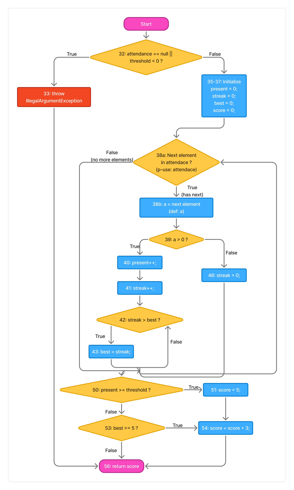
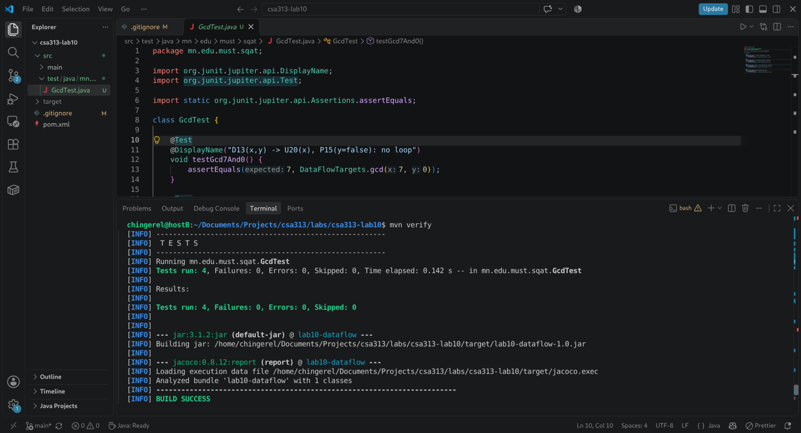
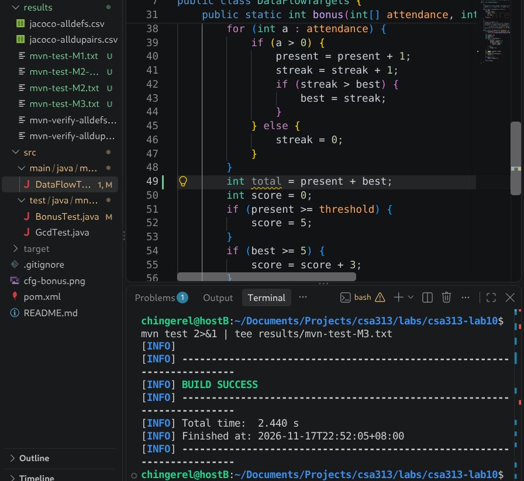

# Lab 10 — Өгөгдлийн урсгалын тест: Definition-Use хосууд

**Хичээл:** F.CSA313 — Программ хангамжийн чанарын баталгаа ба тест  
**Оюутны нэр:** С.Чингэрэл  
**Оюутны код:** B232270010

## Орчны мэдээлэл

### Java version

```text
openjdk version "21.0.13" 2026-10-20
OpenJDK Runtime Environment (build 21.0.13+9-1-deb13u2-Debian)
OpenJDK 64-Bit Server VM (build 21.0.13+9-1-deb13u2-Debian, mixed mode, sharing)
```

### Maven version

```text
Apache Maven 3.9.9
Maven home: /usr/share/maven
Java version: 21.0.13, vendor: Debian, runtime: /usr/lib/jvm/java-21-openjdk-amd64
Default locale: en_US, platform encoding: UTF-8
OS name: "linux", version: "6.12.115+deb13.1-amd64", arch: "amd64", family: "unix"
```

---

# Хэсэг A. GCD функцийн DU шинжилгээ

## A1. Definition / Use цэгүүд

`gcd(x, y)` функцэд дараах хувьсагчид ашиглагдана.

| Хувьсагч | Definition (Def) | Use |
|---|---|---|
| x | 13, 17 | 16 (c-use), 20 (c-use) |
| y | 13, 18 | 15 (p-use), 16 (c-use), 17 (c-use) |
| tmp | 16 | 18 (c-use) |

- **Def:** Хувьсагчид утга оноож байгаа цэг.
- **c-use:** Тооцоолол болон утга буцаахад ашиглах.
- **p-use:** Нөхцөл шалгахад ашиглах.

## A2. DU pair хүснэгт

| Хувьсагч | Def | Use | Use төрөл | Def-clear зам | Тест |
|---|---:|---:|---|---|---|
| x | 13 | 16 | c-use | 13 → 15(T) → 16 | testGcd0And5 |
| x | 13 | 20 | c-use | 13 → 15(F) → 20 | testGcd7And0 |
| x | 17 | 16 | c-use | 17 → 18 → 15(T) → 16 | testGcd12And8 |
| x | 17 | 20 | c-use | 17 → 18 → 15(F) → 20 | testGcd0And5 |
| y | 13 | 15 | p-use | 13 → 15 (T/F) | testGcd7And0, testGcd0And5 |
| y | 13 | 16 | c-use | 13 → 15(T) → 16 | testGcd0And5 |
| y | 13 | 17 | c-use | 13 → 15(T) → 16 → 17 | testGcd0And5 |
| y | 18 | 15 | p-use | 18 → 15 (T/F) | testGcd0And5, testGcd12And8 |
| y | 18 | 16 | c-use | 18 → 15(T) → 16 | testGcd12And8 |
| y | 18 | 17 | c-use | 18 → 15(T) → 16 → 17 | testGcd12And8 |
| tmp | 16 | 18 | c-use | 16 → 17 → 18 | testGcd0And5 |

**Тайлбар:** p-use-ийн T/F салааг нөхцөлийн хоёр өөр үр дүн гэж үзнэ. `gcd(7,0)` нь давталт орохгүй замыг шалгаж, `gcd(0,5)` болон олон давталттай тестүүд давталтын доторх DU хосуудыг шалгана.

## A3. JUnit тестүүдийн тайлбар

`GcdTest.java` файлд дараах тестүүдийг хэрэгжүүлсэн.

| Тестийн нэр | Оролт | Хүлээгдэж буй үр дүн | Зорилго |
|---|---|---:|---|
| testGcd7And0 | gcd(7, 0) | 7 | Давталтгүй зам |
| testGcd0And5 | gcd(0, 5) | 5 | Давталтын нэг удаагийн гүйцэтгэл |
| testGcd12And8 | gcd(12, 8) | 4 | Олон давталт |
| testGcd18And12 | gcd(18, 12) | 6 | Нэмэлт олон давталтын тохиолдол |

---

# Хэсэг B. Bonus функцийн DU шинжилгээ

## B1. Control Flow Graph (CFG)

`bonus()` функцийн Control Flow Graph:



CFG-д дараах үндсэн урсгалуудыг харуулсан:

- Оролтын шалгалт.
- `for-each` давталтын нөхцөл ба алхам.
- Ирцтэй болон тасалсан өдрийн салаалал.
- Дараалсан ирцийн хамгийн их утгыг шинэчлэх.
- Оноо тооцоолох нөхцөлүүд.
- Эцсийн оноог буцаах.

`for-each` давталтын 38-р мөрийг хоёр хэсэгт авч үзсэн:

- Нөхцөл: `attendance` массивт дараагийн элемент байгаа эсэх.
- Алхам: дараагийн элементийг `a` хувьсагчид оноох.

## B2. Definition / Use жагсаалт

| Хувьсагч | Definition | c-use | p-use |
|---|---|---|---|
| attendance | 31 | — | 32, 38 |
| threshold | 31 | — | 32, 50 |
| present | 35, 40 | 40 | 50 |
| streak | 36, 41, 46 | 41 | 42 |
| best | 37, 43 | — | 42, 53 |
| a | 38 | — | 39 |
| score | 49, 51, 54 | 54, 56 | — |

## B3. DU pair хүснэгт

DU pair гэдэг нь нэг хувьсагчийн definition-ээс тухайн хувьсагчийн use хүртэл өөр definition-ээр таслагдаагүй замыг хэлнэ.

| Хувьсагч | Def | Use | Төрөл | Def-clear зам / нөхцөл |
|---|---:|---:|---|---|
| attendance | 31 | 32 | p-use | Оролтын null шалгалт |
| attendance | 31 | 38 | p-use | Null биш массивын давталтын шалгалт |
| threshold | 31 | 32 | p-use | Сөрөг эсэхийг шалгах |
| threshold | 31 | 50 | p-use | Давталтын дараах босго шалгалт |
| present | 35 | 40 | c-use | Эхний эерэг ирц дээр нэмэгдүүлэх |
| present | 35 | 50 | p-use | Эерэг элементгүй үед |
| present | 40 | 40 | c-use | Дараагийн эерэг элемент дээр |
| present | 40 | 50 | p-use | Давталтын дараах босго шалгалт |
| streak | 36 | 41 | c-use | Эхний элемент эерэг байх |
| streak | 41 | 41 | c-use | Дараалсан эерэг элементүүд |
| streak | 41 | 42 | p-use | Нэмэгдүүлсний дараах харьцуулалт |
| streak | 46 | 41 | c-use | Тасалсны дараа дахин ирэх |
| best | 37 | 42 | p-use | Эхний эерэг элемент дээр streak > best |
| best | 43 | 42 | p-use | Best шинэчлэгдсэний дараах харьцуулалт |
| best | 37 | 53 | p-use | Эерэг ирцгүй массивын дараа |
| best | 43 | 53 | p-use | Best шинэчлэгдсэн тохиолдолд |
| a | 38 | 39 | p-use | Авсан элементийн утгыг шалгах |
| score | 49 | 54 | c-use | present босго хангаагүй, best ≥ 5 |
| score | 49 | 56 | c-use | present босго хангаагүй, best < 5 |
| score | 51 | 54 | c-use | present босго хангасан, best ≥ 5 |
| score | 51 | 56 | c-use | present босго хангасан, best < 5 |
| score | 54 | 56 | c-use | Нэмэлт оноо тооцсоны дараа буцаах |

### Kill нөхцөл ба биелэхгүй хосууд

- `streak`-ийн 46-р мөрийн `streak = 0` нь өмнөх 36 эсвэл 41-р мөрийн definition-ийг kill хийнэ.
- 46-р мөрөөс 42-р мөр хүртэл def-clear зам байхгүй. Учир нь дараагийн эерэг элемент дээр 41-р мөр `streak`-ийг дахин тодорхойлж, 42-р мөрөөс өмнө өмнөх definition-ийг kill хийнэ.
- `score`-ийн 49-р мөрийн definition нь 50-р мөрийн нөхцөл худал үед 54 эсвэл 56-р мөр хүртэл хүрч болно. Харин нөхцөл үнэн бол 51-р мөр `score`-ийг дахин тодорхойлж, 49-р мөрийн definition-ийг kill хийнэ.
- `best`-ийн 37-р мөрийн definition нь массивт эерэг элемент байхгүй үед 53-р мөр хүртэл хүрч болно. Эерэг элемент байвал 43-р мөрөөр шинэ definition үүсч болно.

**Анхаарах:** DU pair хүснэгтийн бүх def-use хосыг def-clear замаар нь шалгаж, kill-ээр таслагдсан хосуудыг DU pair гэж тооцохгүй. JaCoCo-ийн branch coverage нь DU pair бүр хамрагдсаныг дангаараа батлахгүй.

## B4. All-Defs болон All-DU-Pairs тестүүд

### All-Defs

All-Defs хамралтыг хангахын тулд `BonusTest.java` файлд эхний хоёр тестийг хэрэгжүүлсэн.

| Тест | Зорилго |
|---|---|
| testNormal | Ирц тасрах, дараалсан ирцийн reset болон онооны үндсэн урсгал |
| testBest5 | Дараалсан 5 ирц, threshold хангах болон нэмэлт оноо |

All-Defs шатны үр дүн:

- Нийт тест: 6
- Алдаа: 0
- JaCoCo Branch: 14/16
- JaCoCo Line: 23/25

### All-DU-Pairs

All-DU-Pairs шатанд дараах нэмэлт тестүүдийг оруулсан:

| Тест | Зорилго |
|---|---|
| testEmpty | Хоосон массив |
| testAllAbsent | Бүх өдөр тасалсан |
| testStreakResetThenFive | Ирц тасалсны дараа таван өдөр дараалан ирэх |
| testStreakSix | Зургаан өдөр дараалан ирэх |
| testThresholdOnly | Threshold хангагдсан боловч best тав хүрэхгүй |
| testInvalidNullAttendance | null массив |
| testInvalidNegativeThreshold | Сөрөг threshold |

All-DU-Pairs үндсэн шатны үр дүн:

- Нийт тест: 13
- Алдаа: 0
- JaCoCo Branch: 16/16
- JaCoCo Line: 24/25

M2 мутацийг илрүүлэх `testKillM2WrongBestVariable` тестийг дараа нь нэмж, эцсийн тестийн тоог 14 болгосон.

## B5. JaCoCo хамралтын үр дүн

| Үзүүлэлт | All-Defs | All-DU-Pairs / Final |
|---|---:|---:|
| Instruction Covered | 64/72 | 69/72 |
| Branch Covered | 14/16 | 16/16 |
| Branch Coverage | 87.5% | 100% |
| Line Covered | 23/25 | 24/25 |
| Line Coverage | 92% | 96% |

Эцсийн JaCoCo тайланд `BRANCH_MISSED = 0` буюу 16 салаалал бүгд хамрагдсан.

`LINE_MISSED = 1` нь Java-ийн далд үүсгэгч constructor-той холбоотой бөгөөд лабораторийн зааврын дагуу хэвийн үр дүн юм.

**Branch coverage ба DU coverage-ийн ялгаа:**

Branch coverage нь нөхцөлийн салаанууд ажилласан эсэхийг хэмждэг. Харин DU analysis нь хувьсагчийн тодорхойлолтоос хэрэглээ хүртэлх def-clear замыг шалгадаг. Иймээс Branch coverage 100% болсон ч зарим DU pair тестээр хамрагдаагүй үлдэх боломжтой.

---

# Хэсэг C. Fault Seeding

Энэ хэсэгт өгөгдлийн урсгалын гурван төрлийн алдааг эх код дээр түр оруулж, JUnit тестүүдээр шалгасан. Туршилт бүрийн дараа эх кодыг `git restore` командаар сэргээсэн.

## C1. M1 — Missing Update

`streak = streak + 1;` мөрийг түр устгасан.

Үр дүн:

| Тест | Expected | Actual |
|---|---:|---:|
| testBest5 | 8 | 5 |
| testStreakResetThenFive | 8 | 5 |
| testStreakSix | 8 | 5 |

Нийт 14 тестээс 3 тест алдаа илрүүлсэн.

**Дүгнэлт:** `streak` шинэчлэгдэхгүй бол дараалсан ирцийн тоо зөв өсөхгүй. Үүний улмаас `best >= 5` нөхцөл биелэхгүй болж нэмэлт оноо олгогдохгүй.

## C2. M2 — Wrong Variable

`best = streak;` мөрийг `best = present;` болгон өөрчилсөн.

Эхний 13 тест бүгд амжилттай болсон. Иймээс анхны All-DU-Pairs тестүүд M2 мутацийг илрүүлж чадаагүй.

Үүнийг илрүүлэхийн тулд дараах тестийг нэмсэн:

`testKillM2WrongBestVariable`

```java
int[] attendance = {1, 0, 1, 1, 1, 1};
assertEquals(5, DataFlowTargets.bonus(attendance, 5));
```

Үр дүн:

| Үзүүлэлт | Утга |
|---|---:|
| Expected | 5 |
| Actual | 8 |
| Илрүүлсэн тест | testKillM2WrongBestVariable |

**Дүгнэлт:** Ирцтэй өдрийн нийт тоо `present = 5` боловч хамгийн урт дараалсан ирц `best = 4` байна. Зөв код 5 оноо буцаах ёстой. Харин `best = present` гэсэн буруу оноолт нэмэлт 3 оноо олгож, 8 болгосон. Нэмэлт тест энэ алдааг илрүүлсэн.

## C3. M3 — Dead Definition

Давталтын дараа дараах мөрийг түр нэмсэн:

```java
int total = present + best;
```

`total` хувьсагчийг цаашид ашиглаагүй.

Үр дүн:

- Нийт тест: 14
- Failures: 0
- Errors: 0
- BUILD SUCCESS

**Дүгнэлт:** `total` хувьсагч програмын эцсийн үр дүнд нөлөөлөхгүй тул JUnit тестүүд энэ алдааг илрүүлээгүй. Ийм төрлийн ашиглагдаагүй definition-ийг IDE-ийн Static Analysis хэрэгслээр илрүүлэх боломжтой.

## Туршилтын screenshot нотолгоо

### GCD тестийн үр дүн



### M3 Dead Definition туршилтын үр дүн



---

# Дүгнэлт

Энэ лабораторийн ажлаар GCD болон bonus функцүүдэд өгөгдлийн урсгалын шинжилгээ хийж, хувьсагч бүрийн definition болон use цэгүүдийг тодорхойлсон. DU pair хүснэгт нь хувьсагчийн утга хаана тодорхойлогдож, хаана хэрэглэгдэж байгааг илүү нарийвчлан ойлгоход тусалсан. All-Defs болон All-DU-Pairs тестүүдийг тусдаа үе шаттай хэрэгжүүлсэн. JaCoCo-ийн эцсийн тайланд branch coverage 100% болсон боловч энэ үзүүлэлт дангаараа бүх DU pair хамрагдсаныг батлахгүй гэдгийг ажигласан. Fault Seeding туршилтаар M1 болон M2 алдааг тестүүдээр илрүүлсэн. Харин M3 Dead Definition нь функциональ үр дүнд нөлөөлөөгүй тул JUnit тестээр илрээгүй бөгөөд Static Analysis шаардлагатайг ойлгосон. Энэ ажлын хамгийн чухал хэсэг нь DU pair-уудыг зөв тодорхойлж, def-clear зам болон kill нөхцөлийг шалгах байлаа.
